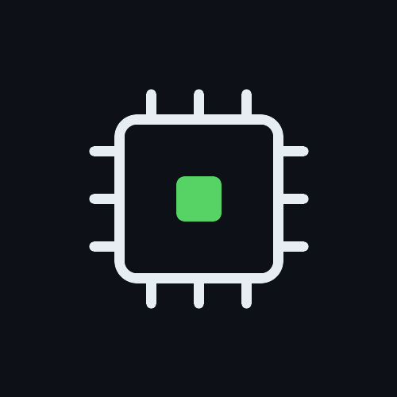

  

<h1 align="center">Tiny Computers</h1>

  Small, readable implementations of real computer systems, built from scratch.

---

## What is this?

Real computers are enormous. The ideas inside them are not.

**Tiny Computers** is a series of small projects that rebuild the core of GPUs, TPUs, CPUs and compilers in a form you can read in an afternoon, run on your own machine, and actually understand. Each project strips a system down to its essential mechanism and makes it visible.

## The series

| Project | What it shows | Links |
|---|---|---|
| [**tiny-gpu**](https://github.com/tinycomputers/tiny-gpu) | Explore parallel threads, registers and memory in a Python GPU simulator | [Demo](https://tinycomputers.github.io/tiny-gpu/) |
| [**tiny-tpu**](https://github.com/tinycomputers/tiny-tpu) | Watch a 4×4 SystemVerilog systolic array run in the browser | [Visualizer](https://tiny-tpu.vercel.app/app) |
| [**tiny-cpu**](https://github.com/tinycomputers/tiny-cpu) | Step through a RISC-V CPU and its five-stage pipeline | [Visualizer](https://tiny-cpu.vercel.app/app) |
| [**tiny-attention**](https://github.com/tinycomputers/tiny-attention) | Explore a FlashAttention engine and its online softmax schedule | [Visualizer](https://tiny-attention.vercel.app/app) |
| [**tiny-compiler**](https://github.com/tinycomputers/tiny-compiler) | Compile a tensor program for the GPU simulator and TPU | [Compiler explorer](https://tiny-compiler.vercel.app/app) |

More are on the way.

## Principles

- **Small.** If it does not fit in your head, it is not tiny enough.
- **Readable.** Code and docs are written to be learned from.
- **Real.** Simplified, never fake. The mechanisms are the ones real hardware and software use.
- **Visible.** Where possible, you can watch it run.

## Follow along

Built by [Dineth Hettiarachchi](https://github.com/deaneeth) · [deaneeth.dev](https://deaneeth.dev)

Explore all five projects and try simplified interactive explanations at [tinycomputers.vercel.app](https://tinycomputers.vercel.app). Star a project to follow its progress.
